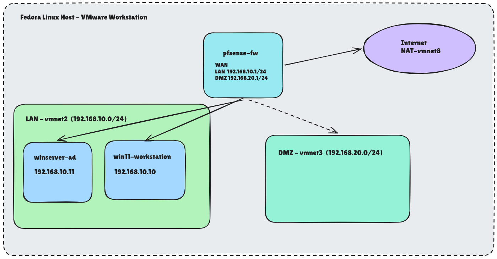

# SOC-Lab-IaC: Automated Security Operations Center Lab


An Infrastructure-as-Code driven SOC lab for a Linux Fedora host running VMware Workstation Pro. It builds a segmented and isolated security environment behind a pfSense firewall, provisions an Active Directory domain populated with synthetic adversarial data via **BadBlood**, and deploys endpoint telemetry and detection tooling with **Sysmon** and **CrowdSec**.

The entire lab is orchestrated through a single `setup.sh` workflow, with Ansible handling post-install configuration and Packer handling Windows Server image provisioning.



> ** Lab Environment Only**
>
> This project is designed to run inside an isolated VMware environment for security research, detection engineering, and SOC practice. Do not expose the Windows/Active Directory lab networks directly to untrusted networks or the public Internet. The generated Active Directory data is intentionally synthetic and adversarial-looking.

---

## Table of Contents

* [Overview](#overview)
  * [Core Components](#core-components)
* [Architecture](#architecture)
* [Lab Workflow](#lab-workflow)
* [Prerequisites](#prerequisites)
  * [Download Required ISO Files](#download-required-iso-files)
* [Directory Structure](#directory-structure)
* [Quick Start](#quick-start)
  * [pfSense Installation](#pfsense-installation)
* [What's Actually Configured](#whats-actually-configured)
  * [DMZ / Future SIEM](#dmz--future-siem)
* [Known Limitations](#known-limitations)
* [Troubleshooting](#troubleshooting)
* [Teardown](#teardown)
* [License & Credits](#license--credits)

---

## Overview

**SOC-Lab-IaC** is a reproducible blue-team/security operations lab designed for:

* Windows and Active Directory security monitoring
* Detection engineering
* Endpoint telemetry collection
* Attack-surface simulation
* SOC tooling experimentation
* Network segmentation and firewall testing
* Security automation with Ansible
* Infrastructure provisioning with Packer

The lab creates a realistic Windows enterprise-style environment while keeping the components isolated inside VMware Workstation.

### Core Components

| Component                  | Purpose                                           |
| -------------------------- | ------------------------------------------------- |
| **pfSense**                | Firewall, router, and network segmentation        |
| **Windows Server 2022**    | Active Directory Domain Controller                |
| **Windows 11 Enterprise**  | Domain-joined workstation                         |
| **BadBlood**               | Synthetic/adversarial Active Directory population |
| **Sysmon**                 | Process, network, and filesystem telemetry        |
| **CrowdSec**               | Log-based behavioral detection and remediation    |
| **Ansible**                | Post-install configuration and orchestration      |
| **Packer**                 | Windows Server image provisioning                 |
| **VMware Workstation Pro** | Virtualization platform                           |

---

## Architecture

The lab is divided into separate VMware virtual networks.

| Zone    | vmnet  | Subnet            | Purpose                                   |
| ------- | ------ | ----------------- | ----------------------------------------- |
| **WAN** | vmnet8 | DHCP              | Host's internet connection                |
| **LAN** | vmnet2 | `192.168.10.0/24` | Windows/AD network                        |
| **DMZ** | vmnet3 | `192.168.20.0/24` | Reserved for future SIEM deployment       |

### Machines

| Machine               | Role                                    | IP              |
| --------------------- | --------------------------------------- | --------------- |
| **pfSense-fw**        | Firewall / Router                       | `192.168.10.1`  |
| **winserver-ad**      | Windows Server 2022 / Domain Controller | `192.168.10.11` |
| **win11-workstation** | Windows 11 / Domain-joined endpoint     | `192.168.10.10` |

The Windows hosts run **Sysmon** and **CrowdSec** for endpoint telemetry and detection.

### Network Flow

```text
                         Internet
                            │
                            ▼
                       VMware vmnet8
                         (WAN/NAT)
                            │
                            ▼
                     ┌──────────────┐
                     │   pfSense    │
                     │  Firewall    │
                     └──────┬───────┘
                            │
              ┌─────────────┴─────────────┐
              │                           │
              ▼                           ▼
       VMware vmnet2                VMware vmnet3
       192.168.10.0/24             192.168.20.0/24
              │                           │
      ┌───────┴────────┐             Reserved for
      │                │             future SIEM
      ▼                ▼
 Windows Server     Windows 11
 192.168.10.11     192.168.10.10
      │                │
      └───────┬────────┘
              │
              ▼
       soclab.local AD
              │
      ┌───────┴────────┐
      │                │
      ▼                ▼
   Sysmon           CrowdSec
```
## Lab Workflow

The complete deployment follows this general workflow:

```text
   setup.sh
       │
       ▼
Configure VMware VMnets
       │
       ▼
Create & install pfSense
       │
       ▼
Build Windows Server 2022
       │
       ▼
Create Windows 11 VM
       │
       ▼
Ansible configuration
       │
       ├──► Promote Windows Server to DC
       │
       ├──► Populate AD with BadBlood
       │
       ├──► Join Windows 11 to domain
       │
       ├──► Install/configure Sysmon
       │
       └──► Install/configure CrowdSec
       │
       ▼
   SOC Lab Ready
       │
       ▼
Detection / Monitoring / Security Testing
```
## Prerequisites

### Host Requirements

* Fedora Linux or compatible Linux distribution
* VMware Workstation Pro installed and available in `PATH`
* **16 GB+ RAM**
* **80 GB+ free disk space**
* Internet connection for downloading required software/dependencies

### Required Tools

The following tools must be installed:

* `packer`
* `ansible-playbook`
* `genisoimage`
* `vmware-vdiskmanager`
* VMware Workstation Pro utilities

Run:

```bash
./check_prereqs.sh
```
 at any time to verify:
* Required tools
* Required ISO files
* Available RAM
* Available disk space
* VMware VMnet configuration

---

## Download Required ISO Files

Due to licensing restrictions, the required operating system ISOs must be downloaded manually and placed in their respective directories before starting the orchestration.

| Operating System          | Download                                                                                                 | Target Directory                  | Notes                                                                |
| ------------------------- | -------------------------------------------------------------------------------------------------------- | --------------------------------- | -------------------------------------------------------------------- |
| **pfSense CE**            | [Netgate Download](https://www.pfsense.org/download/)                                                    | `packer/pfsense/iso/`             | Select `amd64` → `DVD Image (ISO)`. Extract the `.gz` archive first. |
| **Windows Server 2022**   | [Microsoft Evaluation Center](https://www.microsoft.com/en-us/evalcenter/evaluate-windows-server-2022)   | `packer/windows-server-2022/iso/` | Use the 180-day Evaluation ISO.                                      |
| **Windows 11 Enterprise** | [Microsoft Evaluation Center](https://www.microsoft.com/en-us/evalcenter/evaluate-windows-11-enterprise) | `packer/windows-11/iso/`          | Use the 90-day Evaluation ISO.                                       |

### pfSense ISO

The pfSense download is provided as a compressed archive in some distributions.

Extract it before use:

```bash
gunzip pfsense.iso.gz
```

### ISO Detection

For Windows 11, the automation automatically detects the ISO file.

Make sure there is **exactly one** `.iso` file in:

```text
packer/windows-11/iso/
```

For Windows Server 2022, ensure the ISO filename matches the `iso_url` variable in the relevant `.pkr.hcl` file.

Alternatively, edit the `.pkr.hcl` file to match your downloaded ISO filename.

---

## Directory Structure

```text
.
├── ansible/
│   ├── ansible.cfg
│   ├── requirements.yml           
│   ├── inventory/
│   │   └── hosts.ini
│   └── playbooks/
│       ├── 02-ad-domain.yml
│       ├── 03-badblood.yml
│       ├── 04-workstation-join.yml
│       ├── 05-sysmon.yml
│       └── 06-crowdsec.yml
│
├── docs/
│   ├── config-pfSense.xml         
│   ├── pfsense-install-guide.md  
│   └── screenshots/               
│
├── network/
│   ├── create-win11-vm.sh         
│   └── vmnet-config.sh            
│
├── packer/
│   ├── pfsense/
│   │   ├── pfsense.pkr.hcl        
│   │   └── iso/                   
│   ├── windows-11/
│   │   ├── answer-files/
│   │   │   └── autounattend.xml   
│   │   └── iso/                   
│   └── windows-server-2022/
│       ├── winserver.pkr.hcl      
│       ├── answer-files/
│       │   └── autounattend.xml
│       └── iso/                   
│
├── vms/                           
├── .env.example                   
├── check_prereqs.sh               
├── setup.sh                       
└── teardown.sh                    
```

---

# Quick Start and Configuration Details

## Quick Start

### 1. Clone the repository

```bash
git clone <repository-url>
cd SOC-Lab-IaC
```

### 2. Configure environment variables

```bash
cp .env.example .env
```

Edit `.env` and configure the required credentials/settings.

> **Security:** `.env` contains lab credentials and must never be committed to version control. Keep `.env.example` as the safe template and use unique credentials for each deployment.

### 3. Install Ansible dependencies

```bash
ansible-galaxy collection install -r ansible/requirements.yml
```

### 4. Check prerequisites

```bash
./check_prereqs.sh
```

### 5. Build the lab

```bash
./setup.sh
```

`setup.sh` performs the following operations in order:

1. Configure VMware VMnet2 and VMnet3
2. Create and boot the pfSense VM
3. Pause for manual pfSense installation
4. Build Windows Server 2022 using Packer
5. Build Windows 11 using `create-win11-vm.sh`
6. Start the Windows machines
7. Execute the Ansible playbooks
8. Promote Windows Server to a Domain Controller
9. Populate Active Directory with BadBlood
10. Join Windows 11 to the domain
11. Install/configure Sysmon
12. Install/configure CrowdSec

**Estimated first-run time:** 60–90 minutes depending on hardware, network speed, and VMware performance.

---

## pfSense Installation

The pfSense installation is intentionally manual.

Netgate Installer's boot flow does not provide a stable answer-file mechanism suitable for this workflow. Therefore, `setup.sh` opens the pfSense VM in a visible VMware window and waits for the installation to be completed.

> **Detailed Guide:** See [`docs/pfsense-install-guide.md`](docs/pfsense-install-guide.md) for the complete step-by-step installation walkthrough.

### Manual Installation Steps

1. Open the VMware window launched by `setup.sh`.

2. Complete the FreeBSD-based pfSense CE installation using the default installation options.

3. Reboot the VM when prompted.

4. Access the temporary pfSense WebGUI from the host:

   ```text
   https://172.16.1.131
   ```

5. Log in to the pfSense WebGUI.

6. Navigate to:

   ```text
   Diagnostics → Backup & Restore
   ```

7. Restore:

   ```text
   docs/config-pfSense.xml
   ```

8. Wait for pfSense to reboot and apply the configuration.

> **Important:** After restoring the configuration, the pfSense WebGUI IP changes.

The WebGUI will become available at:

```text
https://192.168.10.1
```

9. Verify that the new configuration is active.
10. Return to the terminal running `setup.sh`.
11. Press **ENTER** to continue the orchestration.

---

## What's Actually Configured

### Active Directory

The lab creates a fresh Active Directory forest:

```text
Domain: soclab.local
Domain Controller: winserver-ad
DC IP: 192.168.10.11
```

BadBlood populates the domain with approximately:

* **2,500 users**
* **500 groups**
* **100 computers**

This provides a much more realistic Active Directory attack surface than a minimal test domain.

### Ansible Playbooks

The post-install configuration is split into dedicated playbooks:

| Playbook                  | Function                                                      |
| ------------------------- | ------------------------------------------------------------- |
| `02-ad-domain.yml`        | Promotes Windows Server to a Domain Controller                |
| `03-badblood.yml`         | Populates Active Directory with synthetic/adversarial objects |
| `04-workstation-join.yml` | Joins Windows 11 to `soclab.local`                            |
| `05-sysmon.yml`           | Installs and configures Sysmon                                |
| `06-crowdsec.yml`         | Installs and configures CrowdSec                              |

### Sysmon

Sysmon is deployed to both Windows hosts using a **SwiftOnSecurity-based configuration**.

Telemetry includes:

* Process creation
* Network connections
* File-system activity
* Additional endpoint events defined by the Sysmon configuration

This telemetry is intended for detection engineering and SOC investigation exercises.

### CrowdSec

CrowdSec is installed on both Windows hosts.

Configured collections include:

```text
windows
windows-firewall
base-http-scenarios
http-cve
iis
mssql
```

The goal is to provide log-based behavioral detection and security-response experimentation inside the lab.

### DMZ / Future SIEM

The DMZ network:

```text
192.168.20.0/24
```

is reserved for a future SIEM deployment.

The network is intentionally separated so that a centralized SIEM can be added later without redesigning the existing LAN architecture.

---

# Known Limitations and Troubleshooting

## Known Limitations

### Windows 11 Provisioning vs. Windows Server

While Windows Server 2022 provisions flawlessly and reliably via Packer, Windows 11 exhibits WinRM unreliability and frequent connection timeouts during its automated sysprep phase.

To bypass this limitation and guarantee a smooth build, Windows 11 is built directly via a custom bash script (`network/create-win11-vm.sh`) using `vmrun` and `autounattend.xml`.

### BadBlood Idempotency

BadBlood is designed to be idempotent, but execution is also protected by:

```text
C:\Tools\BadBlood\.badblood_done
```

Once the flag exists, the provisioning step will not run again.

To intentionally repopulate the domain, remove the flag before executing the playbook again.

### Centralized Secrets

Credentials are centralized through `.env` and propagated to Packer and Ansible.

Never commit:

```text
.env
```

to the repository.

Use:

```text
.env.example
```

as the shareable configuration template.

### Evaluation ISOs

Windows Server 2022 and Windows 11 use evaluation media.

Packer may report checksum warnings such as:

```text
ISO checksum = "none"
```

This is expected for the current evaluation-media workflow.

---

# Troubleshooting

## VM Power-On Fails

Inspect the relevant VMware log:

```text
vms/<component>/vmware.log
```

## VMnet Host-Only Adapter Fails

If VMnet2/VMnet3 cannot be enabled or DHCP does not start, VMware's kernel modules may not be loaded.

Check:

```bash
lsmod | grep -E "vmmon|vmnet"
```

If the modules are missing, try rebuilding them.

### Method 1 — VMware Module Repair

```bash
sudo vmware-modconfig --console --install-all
```

Then restart VMware networking if necessary:

```bash
sudo vmware-networks --stop
sudo vmware-networks --start
```

### Method 2 — Community Kernel Module Patch

If your Fedora kernel is newer than the VMware version officially supports, a community-maintained VMware host-module patch may be required.

For example:

```bash
cd /tmp
git clone -b workstation-25h2 https://github.com/philipl/vmware-host-modules.git
cd vmware-host-modules
make
sudo make install
sudo vmware-networks --stop
sudo vmware-networks --start
```

> **Note:** Community kernel modules are dependent on the specific VMware Workstation and Linux kernel versions in use. Verify compatibility before applying them to a production system.

## Ansible WinRM Timeout

Verify that the Windows host is reachable over port 5985:

```bash
# For Windows Server:
nc -zv 192.168.10.11 5985

# For Windows 11:
nc -zv 192.168.10.10 5985
```

> **Username Note:** The default administrator usernames differ between the machines. **Windows Server uses `Administrator`**, while **Windows 11 uses `Admin`**. Ensure you are using the correct user when testing WinRM credentials manually or reviewing the `ansible/inventory/hosts.ini` file.

Make sure:

* The IP address is correct
* WinRM is enabled
* The Windows host is powered on
* The host is connected to the correct VMware network
* Credentials in `.env` match the Ansible inventory

## Packer ISO Warning

Warnings similar to:

```text
ISO checksum = "none"
```

are expected when using evaluation ISOs without a configured checksum.

## Windows 11 ISO Detection

If the Windows 11 build cannot find the ISO, verify:

```bash
ls -lah packer/windows-11/iso/
```

There should be **exactly one** `.iso` file in the directory.

---

# Teardown

To stop and remove the lab:

```bash
./teardown.sh
```

The teardown script:

* Stops all lab VMs
* Removes generated VM files under `vms/`
* Resets the Ansible inventory
* Optionally reverts VMware VMnet definitions
* Optionally deletes downloaded ISOs

The script asks for confirmation before destructive operations such as removing VMnet configuration or ISO files.

---

# License & Credits

This project is released under the **MIT License**. See [`LICENSE`](LICENSE).

The project integrates several third-party technologies and projects, each of which is subject to its own license:

* pfSense
* VMware Workstation Pro
* Microsoft Windows
* Ansible
* Packer
* BadBlood
* Sysmon
* SwiftOnSecurity Sysmon configuration
* CrowdSec

Please review and comply with the respective licenses and terms of use for each component.

---

# Project Goals & Roadmap

The long-term vision of **SOC-Lab-IaC** is to provide a reproducible security laboratory where defenders can experiment with:

* Active Directory attack detection
* Windows endpoint telemetry
* Sysmon event analysis
* Log-based behavioral detection
* Firewall and network segmentation
* Detection engineering
* Incident-response workflows
* Security automation
* Purple-team exercises
