# pfSense Installation Walkthrough

This guide supplements the [Main README](../README.md#pfsense-installation). Screenshots below are from an actual run of this lab using Netgate Installer v1.2 (pfSense CE).

> **Note for Contributors:** If you recreate the environment, rename your own screenshots to match the filenames below and drop them in `docs/screenshots/pfsense-install/` for them to render correctly on GitHub.

---

### 1. Boot menu

VM boots from the Netgate Installer ISO. Just let it boot multi-user (default).

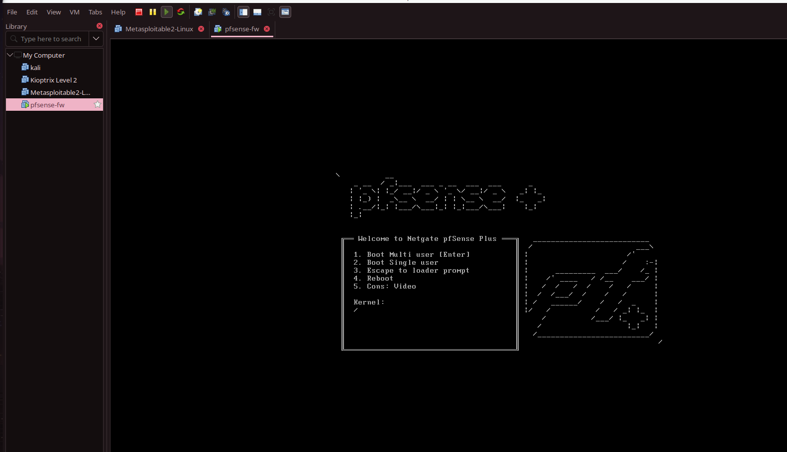

### 2. Copyright and Trademark Notice

Click **Accept**.

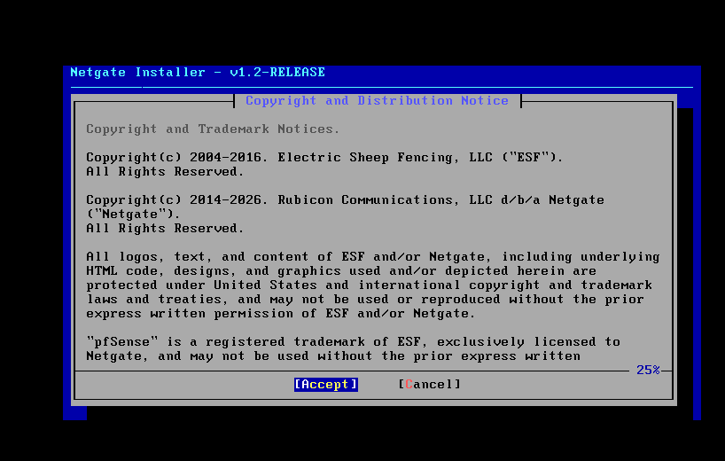

### 3. Welcome — Install vs Rescue Shell

Select **Install** → **Install pfSense**.

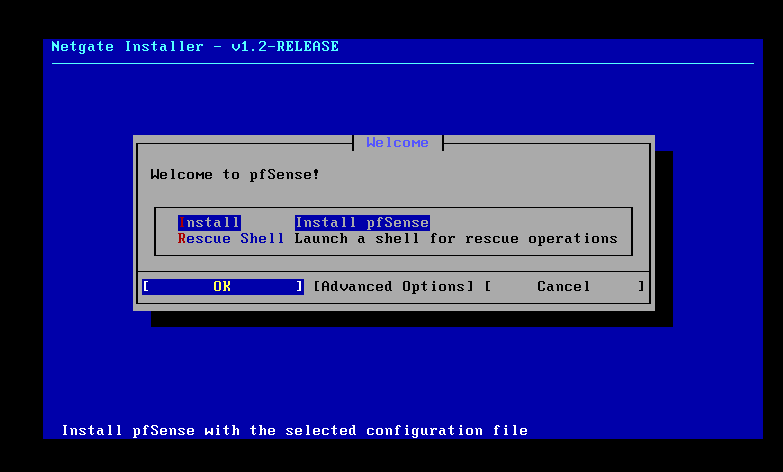

### 4. Subscription validation

This device has no pfSense Plus subscription — that's expected, we want the
free Community Edition. Select **Install CE**.

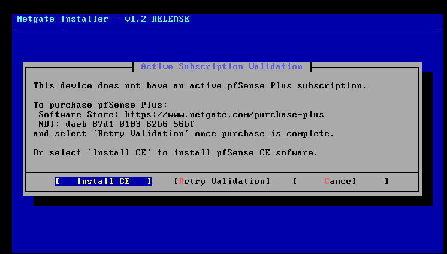

### 5. Select CE version

Pick **Current Stable Version**. Don't use Beta.

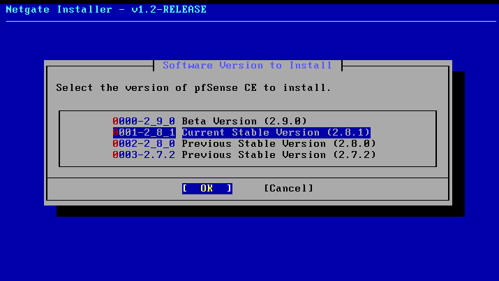

### 6. Installation options (filesystem / partition scheme)

Defaults are fine for a lab: **ZFS** + **GPT**. Select **>> Continue**.

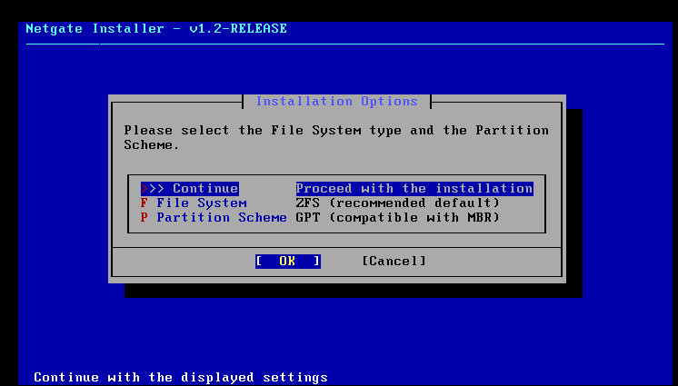

### 7. Confirm disk wipe

**Last chance** warning before destroying the disk. Select **Yes** — this is
a fresh VM, there's nothing to lose.

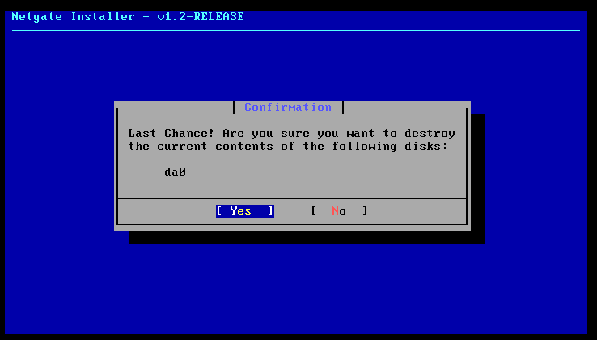

### 8. Interface assignment and configuration

The installer detects it's running in a VMware VM. At this point only one
NIC (`em0`) is assigned to WAN — LAN is not assigned yet. Select
**Assign/Configure** to also assign LAN and OPT1 (these correspond to the
`vmnet2` and `vmnet3` adapters defined in `pfsense.pkr.hcl`).

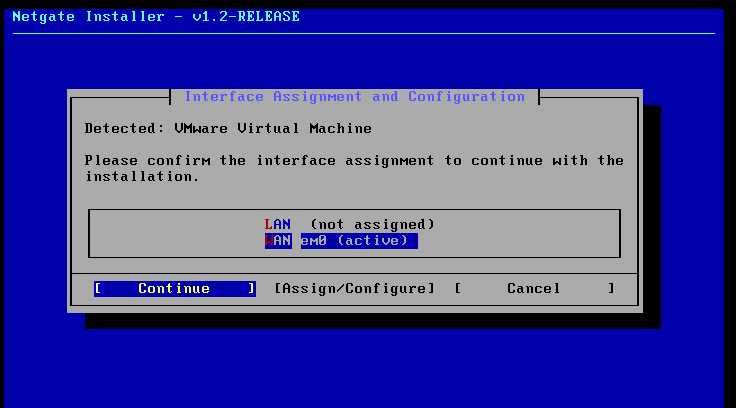

### 9. WAN interface assignment

Confirm `em0` as WAN.

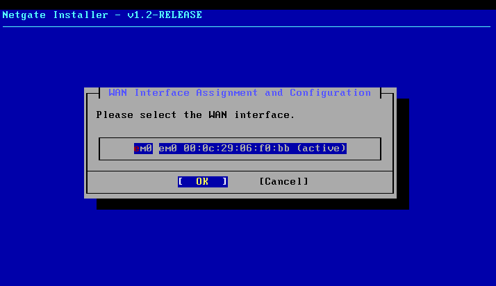

### 10. WAN network mode setup

Leave as **DHCP (client)** — this is the NAT-connected adapter that gets
internet access from the host.

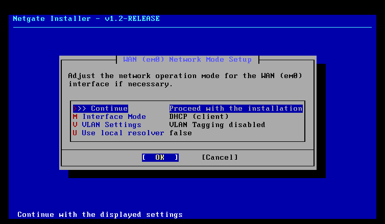

### 11. Installation progress

Packages get fetched and installed. Takes a few minutes depending on your
connection (Netgate Installer downloads pfSense packages during install,
unlike the old all-in-one ISO).

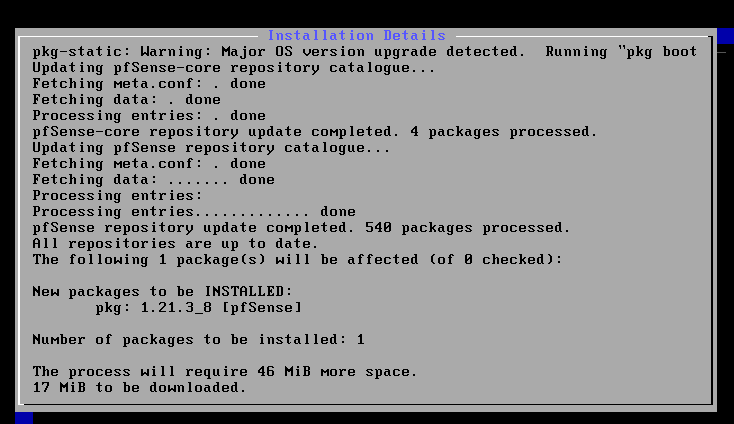

### 12. Post-installation setup complete

Once you see `pfSense Post Installation setup .. done.`, select **OK**.

**Before you reboot** — the VM will boot straight back into the installer if
the install ISO is still attached. Shut the VM down first (don't just reboot
from the installer menu):

1. In the VMware window, power off the VM (top bar → shutdown icon, or
   `vmrun -T ws stop <vmx> soft`).
2. Open **Edit virtual machine settings** → select **CD/DVD (IDE)**.
3. Uncheck **Connect at power on**.
4. **Save**, then start the VM again.

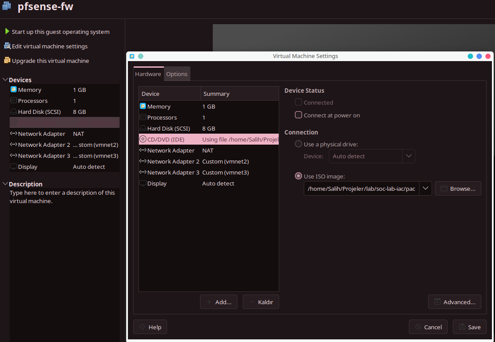

This time it boots from the freshly installed disk instead of the installer,
straight into the pfSense console menu.

---

## WebGUI login

Browsing to `https://172.16.1.131` will show a certificate warning — that's
expected, pfSense uses a self-signed cert by default. Click through
("Advanced" → "Proceed").

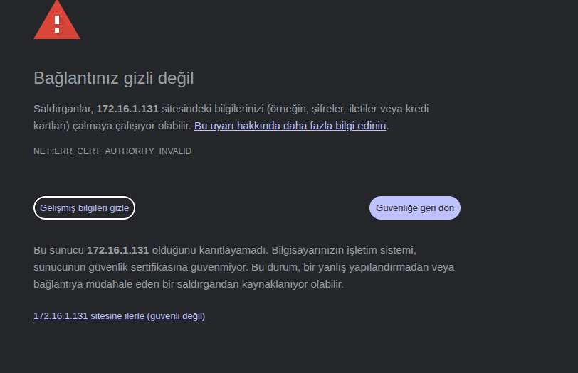

You'll be warned the default `admin`/`pfsense` credentials are insecure —

## Fixing interface assignment mismatches (if any)

If you see **"Interface mismatch detected"** under
**Interfaces → Interface Assignments**, it means the WebGUI's view of
WAN/LAN/OPT1 doesn't match what you set at the console. Re-select the correct
`em0`/`le0`/`le1` mapping for each row, **Save**, then **Apply Changes** —
the firewall will reboot once more to finalize.

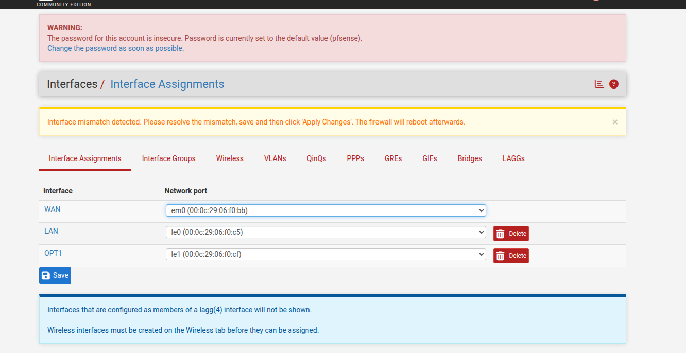
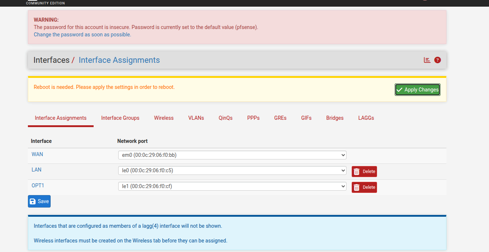

From here, continue with the config restore step described in the main [README](../README.md#pfsense-installation).
