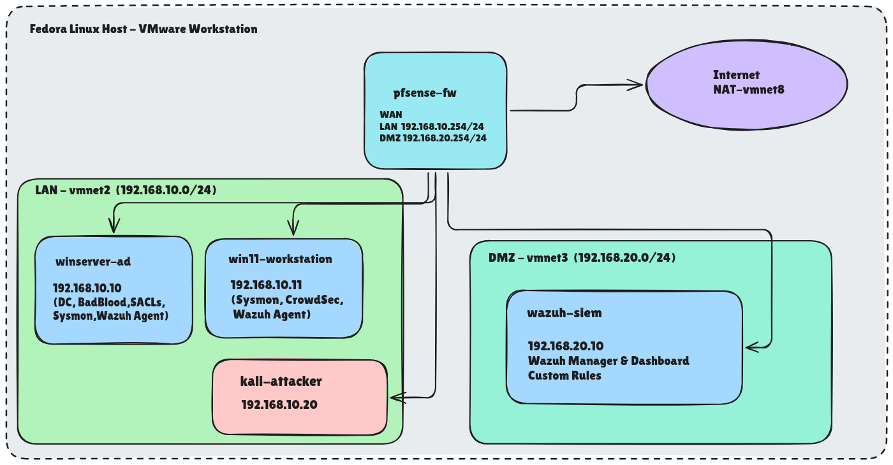
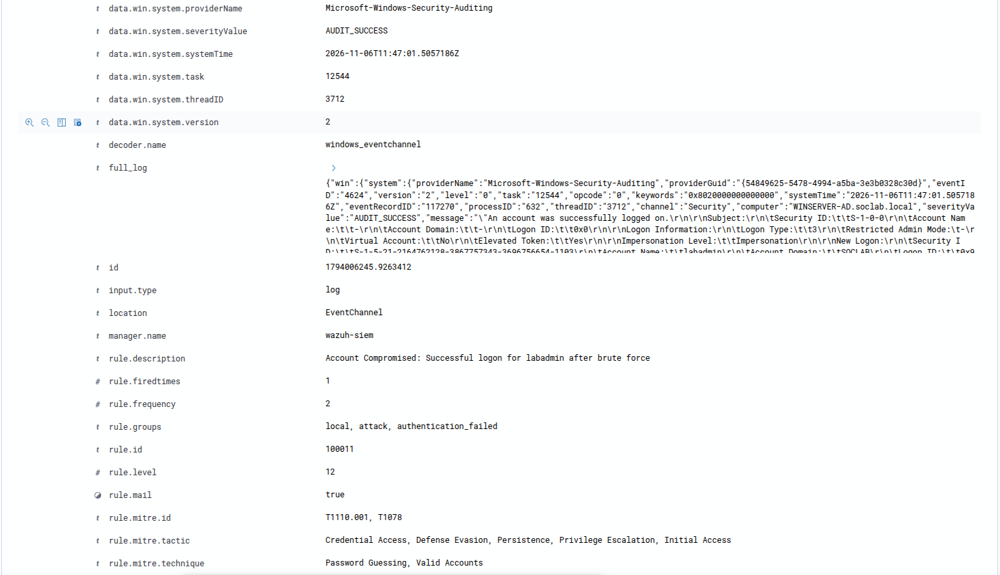
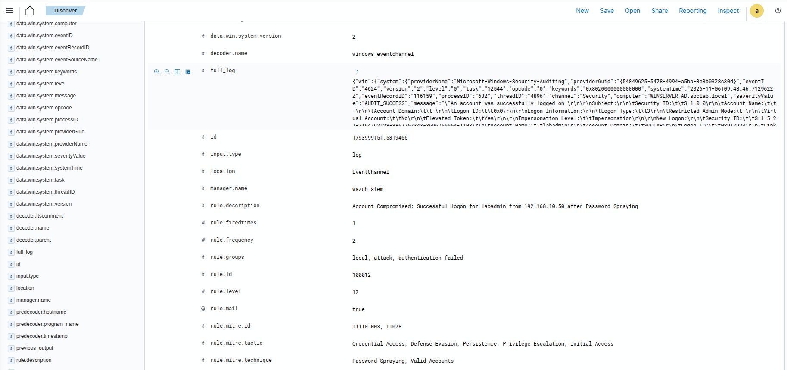
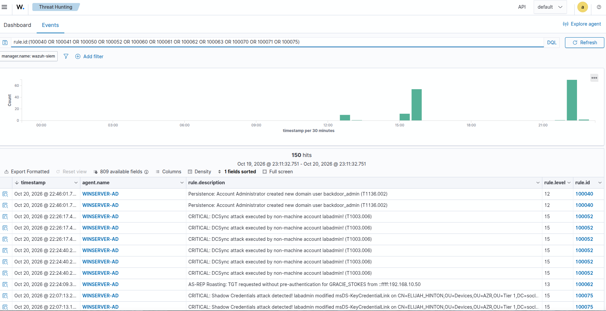
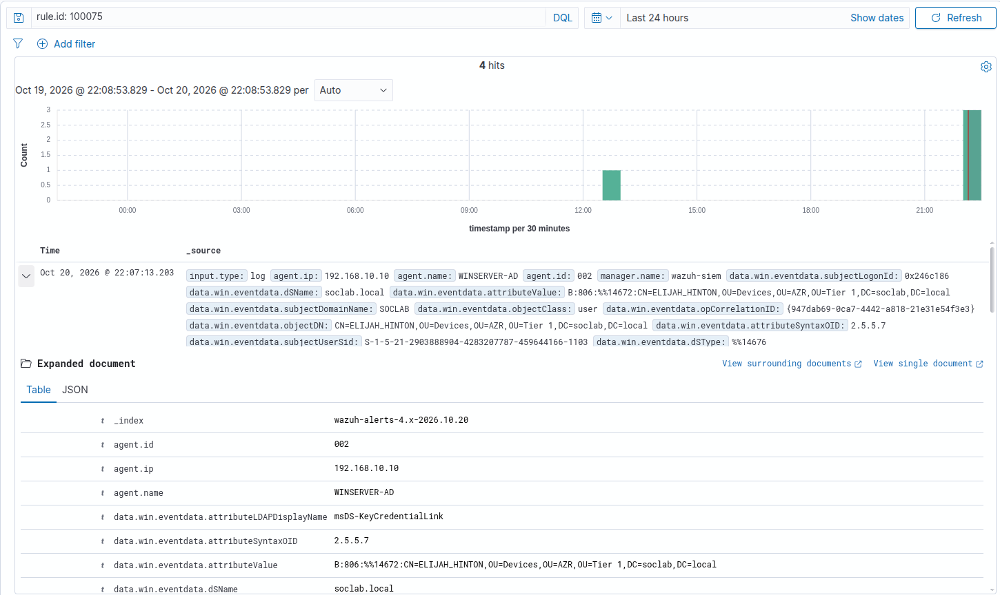
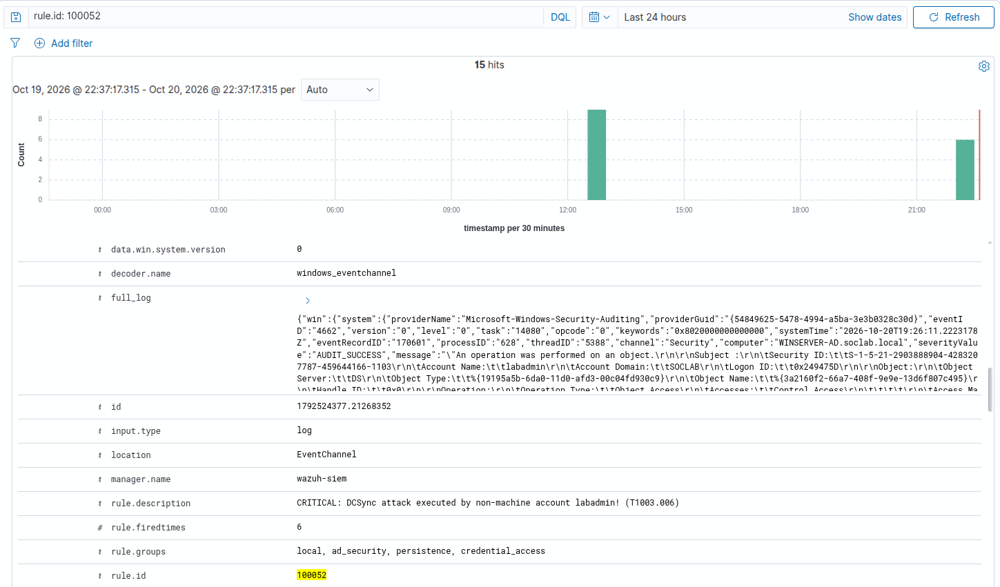

# Purple Team & Detection Engineering Notes (soclab.local)

This document outlines the Active Directory attack scenarios simulated within the `SOC-Lab-IaC` environment and the custom Wazuh detection rules engineered to identify them.

Here are my notes from testing Active Directory attacks in the lab and writing custom Wazuh rules (100010–100080) to catch them without drowning in false positives.

## Lab Topology

| Network Segment | Hostname | IP Address | Role |
| :--- | :--- | :--- | :--- |
| LAN (`192.168.10.0/24`) | `pfSense-fw` | `192.168.10.254` | Firewall / LAN & DMZ Gateway |
| LAN (`192.168.10.0/24`) | `WINSERVER-AD` | `192.168.10.10` | Windows Server 2022 (AD DC & DNS) |
| LAN (`192.168.10.0/24`) | `WIN11-WKS` | `192.168.10.11` | Windows 11 Enterprise (Domain Workstation) |
| LAN (`192.168.10.0/24`) | `kali-attacker` | `192.168.10.20` | Offensive Testing Host |
| DMZ (`192.168.20.0/24`) | `wazuh-siem` | `192.168.20.10` | Ubuntu Server 22.04 (Wazuh SIEM) |

---

## Scenario 1: SMB Brute Force & Password Spraying Detection

In the first scenario, I simulated an attacker on the internal network attempting to compromise domain credentials via `nxc smb` using both targeted brute-force (`T1110.001`) and password spraying (`T1110.003`), followed by a valid logon (`T1078`).

### Rule Engineering Iterations & Challenges

Correlating Windows failed logon events (Event ID `4625` / Wazuh Rule `60122`) with subsequent successful logons (Event ID `4624` / Rule `60106`) required four iterations to eliminate false positives:

1. **Iteration 1 (Field Mapping Mismatch):** My initial rule relied on the `<same_source_ip />` tag, which never triggered. Inspecting the raw JSON alert revealed that Windows EventChannel events under rule `60122` populate the source IP inside `win.eventdata.ipAddress` rather than the standard `srcip` field.
2. **Iteration 2 (Machine Account Loopback Noise):** Switching to `<same_field>win.eventdata.targetUserName</same_field>` got the rule firing, but the Domain Controller's own machine account (`WINSERVER-AD$`) generating local loopback (`::1`) traffic immediately caused false positives.
3. **Iteration 3 (Targeted Brute Force Correlation):** I enforced `targetUserName` matching across both the frequency rule and the follow-up success rule, tying `<if_sid>` to both `60106` (standard logon) and `92652` (NTLM remote logon).
4. **Iteration 4 (Separating Spraying & Filtering Null Sessions):** I split single-user brute forcing (`T1110.001`) and single-IP password spraying (`T1110.003`) into separate correlation chains. Because tools like `nxc` and Impacket frequently initiate SMB null sessions that log as `ANONYMOUS LOGON` and prematurely consume the correlation window, I excluded machine accounts (`\$$`), loopback addresses, and `ANONYMOUS LOGON` using `negate="yes"`.

### Filtered False Positives

* **`WINSERVER-AD$` Loopback Traffic (`::1` / `127.0.0.1`):** Internal DC service traffic excluded via regex negation on IP and trailing `$` on account names.
* **`ANONYMOUS LOGON` Sessions:** Side effects of SMB enumeration tools filtered out so only real user logons trigger compromise alerts.
* **`cleanmgr.exe` DLL Drop (Rule `92213`):** Triggered by Windows background maintenance during `secretsdump` execution; documented as baseline OS noise.

---

## Scenario 2: Active Directory Privilege Escalation & Credential Access Chain

*(Note: Because BadBlood generates randomized object names per deployment, the target accounts and `GenericAll` edges in this scenario were explicitly configured on top of the BadBlood baseline—alongside Advanced Audit Policies (`auditpol`) and AD Root SACLs—to systematically test and verify each detection rule).*

In the second scenario, I simulated a full attack path inside the BadBlood-populated domain—starting from a compromised low-privilege account (`GRACIE_STOKES`), abusing an ACL chain, escalating privileges, and executing Kerberoasting, AS-REP Roasting, Shadow Credentials, and DCSync attacks.

### Attack Execution & Telemetry Analysis

1. **Domain Reconnaissance (`T1087.002`):**
   Using `bloodhound-python`, I collected domain object relationships and identified a 4-hop `GenericAll` ACL abuse path (`GRACIE_STOKES` -> `ELIJAH_HINTON` -> `DAMIEN_GREER` -> `MITCHEL_CLINE` -> `RUSTY_POLLARD`) leading to write permissions over the `USERS` container.

2. **ACL Abuse & Password Reset Chain (`T1078.002` / `T1098`):**
   Using `bloodyAD`, I sequentially reset the passwords along the chain to take over `RUSTY_POLLARD`.
   * **Telemetry:** Each hop generated **Event ID `4724`** (password reset attempt) on the DC.
   * **Detection Strategy:** A single `4724` event only shows *who* reset *whose* password (`subjectUserName` and `targetUserName`), not whether it was an authorized helpdesk action or an ACL abuse. However, a non-machine account resetting 3+ passwords within 5 minutes is a strong indicator of automated ACL traversal (Rule `100070` -> `100071`).

3. **Targeted Kerberoasting (`T1558.003`) & AS-REP Roasting (`T1558.004`):**
   * By writing a `servicePrincipalName` attribute onto target users via `bloodyAD`, **Event ID `5136`** is generated on the DC (`attributeLDAPDisplayName: servicePrincipalName`), which is caught immediately by Rule `100063`.
   * Requesting RC4-encrypted (`0x17`) TGS tickets via `impacket-GetUserSPNs` generates **Event ID `4769`**, triggering Rule `100060` (single SPN) and Rule `100061` (automated sweep of 3+ SPNs within 60 seconds).
   * Disabling Kerberos pre-authentication (`DONT_REQ_PREAUTH`) and requesting TGTs via `impacket-GetNPUsers` generates **Event ID `4768`** with `preAuthType: 0` and `ticketEncryptionType: 0x17`, triggering Rule `100062`.

4. **Shadow Credentials (`T1098`):**
   Using `bloodyAD add shadowCredentials`, an attacker appends a rogue certificate to the target's `msDS-KeyCredentialLink` attribute. Even if AD CS / PKINIT is not active on the KDC, the LDAP directory modification itself logs **Event ID `5136`** on the DC, triggering Rule `100075` (Level 15).

5. **DCSync (`T1003.006`) & Pass-the-Hash (`T1550.002`):**
   Granting replication rights on the domain root logs **Event ID `5136`** (`ntSecurityDescriptor` containing the replication GUIDs `1131f6aa...` / `1131f6ad...`), caught by Rule `100050`. Running `impacket-secretsdump` exercises those replication rights (**Event ID `4662`**), triggering Rule `100052` when executed by any non-machine account.

---

## Custom Wazuh Detection Ruleset Summary

All custom rules are deployed in `/var/ossec/etc/rules/local_rules.xml`:

| Rule ID | Level | Source Event | Detection Logic | MITRE ATT&CK | Status |
| :--- | :--- | :--- | :--- | :--- | :--- |
| `100010` | 10 | Security `4625` (5x/120s) | Targeted SMB brute force against a single user | T1110.001 | Verified |
| `100011` | 12 | Security `4624` | Successful logon following targeted brute force | T1110.001, T1078 | Verified |
| `100020` | 10 | Security `4625` (8x/120s) | Password spraying from a single source IP | T1110.003 | Verified |
| `100012` | 12 | Security `4624` | Successful logon following password spraying | T1110.003, T1078 | Verified |
| `100031` | 12 | Sysmon `EID 10` | Suspicious high-privilege access to `lsass.exe` memory | T1003.001 | Verified |
| `100032` | 15 | Sysmon `EID 10` | Known credential dumping utility accessing `lsass.exe` | T1003.001 | Verified |
| `100040` | 12 | Security `4720` | New domain user created by a non-machine account | T1136.002 | Verified |
| `100041` | 15 | Sysmon `EID 1` | Remote backdoor user creation via Impacket `wmiexec` | T1136.002, T1047 | Verified |
| `100050` | 15 | Security `5136` | DACL modified on AD object to grant DCSync rights | T1484.001, T1098 | Verified |
| `100051` | 3 | Security `4662` | Baseline AD directory replication activity (machine noise) | T1003.006 | Verified |
| `100052` | 15 | Security `4662` | DCSync executed by a non-machine account (`!$`) | T1003.006 | Verified |
| `100060` | 12 | Security `4769` | Kerberoasting: RC4 (`0x17`) TGS requested for user SPN | T1558.003 | Verified |
| `100061` | 15 | Security `4769` (3x/60s) | Automated Kerberoasting sweep from the same IP | T1558.003 | Verified |
| `100062` | 13 | Security `4768` | AS-REP Roasting: TGT requested with `PreAuthType: 0` & RC4 | T1558.004 | Verified |
| `100063` | 14 | Security `5136` | Targeted Kerberoasting: `servicePrincipalName` modified | T1098, T1558.003 | Verified |
| `100070` | 8 | Security `4724` | User password reset attempt by a non-machine account | T1098 | Verified |
| `100071` | 14 | Security `4724` (3x/300s) | Rapid password reset chain (ACL / `GenericAll` abuse) | T1098, T1078.002 | Verified |
| `100075` | 15 | Security `5136` | Shadow Credentials: `msDS-KeyCredentialLink` modified | T1098 | Verified |
| `100080` | 12 | Security `4624` | Suspicious NTLM network logon to privileged account (PtH) | T1550.002 | Verified |

---

## Notes & Gotchas

* **`<if_sid>` vs. `<if_group>` in Wazuh:** Custom rules for Windows events (`4662`, `5136`, `4768`, `4769`) won't fire if you only match `<if_group>windows</if_group>` because built-in rules (`60103`, `60106`, `60229`) already claim them first. You have to hook directly into those parent SIDs (`<if_sid>60103,60106,60229</if_sid>`).
* **Rule Ordering Matters (`100080` vs. `100011`/`100012`):** Wazuh evaluates rules top-to-bottom. Initially, the generic NTLM logon rule (`100080`) caught post-bruteforce logons before `100011` and `100012` could correlate them. Moving `100080` above the correlation rules and adding it to `<if_sid>60106,92652,100080</if_sid>` fixed the chain.
* **`auditpol` Alone Isn't Enough for `4662` / `5136`:** Turning on `Directory Service Access/Changes` via `auditpol.exe` doesn't log DCSync or Shadow Credentials by default. You also need a SACL on the domain root (`DC=soclab,DC=local`) auditing `Everyone` for `ExtendedRight`, `WriteDacl`, and `WriteProperty` (automated in `02-ad-domain.yml`)
* **Kerberos Clock Skew (`KRB_AP_ERR_TKT_EXPIRED`):** Pausing or snapshotting VMs causes clock drift between Kali and the DC. If UTC time drifts by more than 5 minutes, `impacket-GetUserSPNs` and `GetNPUsers` fail before generating any `4768`/`4769` logs
